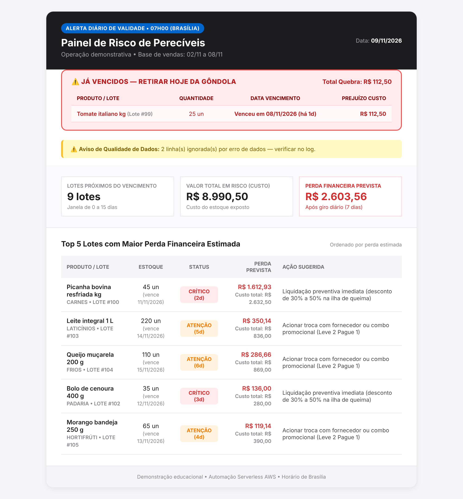

# Alerta de validade de perecíveis

Supermercados podem perder dinheiro quando perecíveis vencem antes de serem vendidos.  
Este projeto demonstra um alerta diário que estima a sobra dos lotes usando vendas recentes.



**Tecnologias:** Python, Lambda, S3, SES, EventBridge, CloudWatch, SNS.

**Resultado:** no exemplo do print acima, gerado com os CSVs fictícios de `data/` em 09/11/2026, o alerta identificou **9 lotes** na janela de risco (0 a 15 dias), estimou **R$ 2.603,56** de perda prevista e destacou **1 lote já vencido**.

## Como funciona

A execução agendada lê CSVs de produtos, lotes e vendas no S3. Calcula a média diária da janela fechada de sete dias (`hoje - 7 dias` até ontem) e simula essa demanda ao longo dos dias restantes. Para cada produto, distribui as vendas entre lotes em ordem **PVPS/FEFO** — primeiro vence, primeiro sai — sem reutilizar a previsão entre lotes. A sobra estimada multiplicada pelo custo unitário produz o valor em reais.

Lotes vencidos são destacados. Linhas inválidas são registradas no CloudWatch e contabilizadas no e-mail. Campos de texto dos CSVs são escapados antes de compor o HTML. Em caso de falha, o e-mail contém somente o resumo do erro; o traceback permanece no CloudWatch.

**Dados:** todos os produtos, lotes, vendas, nomes e valores exibidos são fictícios; não identificam cliente ou supermercado real. A estimativa é demonstrativa, não uma previsão validada nem garantia de economia.

## Aprendizado: UTC × São Paulo

No teste original, a data UTC da Lambda já havia avançado para o dia seguinte enquanto ainda era noite no Brasil. Isso deslocou a janela de vendas e os dias até o vencimento. Naquele conjunto sintético, a estimativa mudou de **R$ 2.603,56** para **R$ 1.819,97**, diferença de **R$ 783,59** (cerca de R$ 800). Esse valor foi observado naquele cenário específico. A correção usa `zoneinfo.ZoneInfo("America/Sao_Paulo")` para definir a data de negócio.

## Testes e dados de demonstração

Requer Python 3.11+.

```bash
python -m venv .venv
source .venv/bin/activate        # Windows: .venv\Scripts\activate
pip install -r requirements.txt pytest
pytest -q
```

Os testes simulam leituras S3 e não enviam e-mails. Para gerar CSVs sintéticos atualizados: `python scripts/generate_sample_data.py`.

## Próximos passos

Conectar um ERP real via exportação para S3, começando por CSV validado. Usar para a integração uma role/conta de serviço **somente de leitura**, com acesso limitado aos dados necessários. Antes de uso operacional, validar a estimativa com histórico autorizado e com o responsável pelo negócio.

## Implantação AWS (referência)

A demonstração usa bucket S3 privado; EventBridge agenda a Lambda diariamente às 07h em São Paulo; a Lambda lê CSVs e envia o relatório pelo SES. CloudWatch guarda logs e monitora `Errors`; o alarme publica no SNS. O destinatário precisa confirmar a subscrição SNS para receber notificações. A infraestrutura testada foi configurada em `sa-east-1`; este repositório não inclui um template IaC completo.

1. Crie um bucket S3 privado, com bloqueio de acesso público e criptografia habilitados. Envie os três arquivos de `data/` para o prefixo `dados/`.
2. Verifique o remetente no SES. Se o SES estiver no sandbox, verifique também o destinatário ou solicite a saída do sandbox.
3. Crie uma role da Lambda com permissões mínimas: leitura apenas dos CSVs necessários no S3, envio via SES e escrita de logs no CloudWatch. Não use `AdministratorAccess` na função.
4. Configure `BUCKET_NAME`, `REMETENTE_EMAIL` e `DESTINATARIO_EMAIL` no ambiente da Lambda. A região vem do runtime; não defina manualmente a variável reservada `AWS_REGION`.
5. Empacote e publique:

```bash
bash scripts/package_lambda.sh
aws lambda update-function-code \
  --function-name "$FUNCTION_NAME" \
  --zip-file fileb://build/lambda_function.zip \
  --region sa-east-1
```

6. Configure uma regra EventBridge `cron(0 10 * * ? *)` para 07h em São Paulo (UTC−3), conceda permissão para invocar a Lambda e associe-a como destino. Revise o horário se fuso ou regra local mudar.
7. Crie um alarme CloudWatch sobre `AWS/Lambda`, métrica `Errors`, dimensão `FunctionName`; conecte-o a um tópico SNS e confirme a subscrição.
8. Faça uma invocação controlada e confira logs, entrega de e-mail e custos. S3, SES, SNS, CloudWatch e transferências podem gerar cobrança; não há garantia de custo zero. Configure orçamento e alertas.

Use AWS CLI com IAM Identity Center/SSO, roles ou credenciais temporárias. Não versionar chaves, senhas, arquivos `.env`, logs reais, IDs de conta, ARNs nem dados de clientes. `.env.example` contém somente valores ilustrativos.
